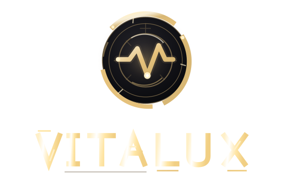

<h3 align="center">Your Linux system at a glance.</h3>

Native system monitoring, live hardware telemetry and performance insights.

<a href="https://github.com/PAAAUUULLOOOH/Vitalux/releases/latest"><strong>Download Vitalux</strong></a> · <a href="#features">Features</a> · <a href="#installation">Installation</a> · <a href="#help">Help</a>

## Features

| Area | Highlights |
| --- | --- |
| **Dashboard** | Live readings, flexible tiles, consistent spacing and system health score |
| **CPU, GPU & memory** | Load, clocks, temperatures, VRAM and history charts |
| **Storage & network** | SMART information, throughput and disk benchmarks |
| **System & sensors** | Distribution, kernel, Mesa, drivers and available sensors |
| **Vitalux Insights** | Performance diagnostics, gaming sessions and comparisons |
| **Appearance** | Seven themes, custom wallpapers, accents and graphics renderers |

### Themes and personalization

**Glass with Vitalux Blue** is the default. Other styles are **Black Glass**, **Black Glass Gold** (fixed gold accent), **Holographic** (opaque sci-fi HUD), **Dark**, **Light** and **Minimal**. Import your own wallpaper or use built-in backgrounds. Wallpaper-derived accent colors are available only with a selected custom image.

## Installation

Get the **AppImage**, **portable ZIP**, or **update ZIP** from [Releases](https://github.com/PAAAUUULLOOOH/Vitalux/releases/latest). Complete packages include the bundled Python/Qt runtime.

- **AppImage:** Mark executable, then launch. Optional per-user installation is supported.
- **Portable ZIP:** Extract everything and start **run.sh**.

Designed for modern **Linux x86-64** on Wayland or X11. Some graphics drivers and system libraries are provided by the host. Sensor availability varies by hardware and permissions. CPU rendering is the default; OpenGL and Qt Quick are optional. Unsupported Qt Quick configurations revert to CPU rendering.

## Help

The built-in guide is under **Info → Guide**. Use **Portable-pruefen.sh** for diagnostics. Logs are stored under **~/.local/state/vitalux/**. To report a problem, [open an issue](https://github.com/PAAAUUULLOOOH/Vitalux/issues).

Made by **[PAAAUUULLOOOH](https://github.com/PAAAUUULLOOOH)**. Thanks to [TimBooH](https://github.com/TimBooH) for help with custom wallpapers and graphics output.
