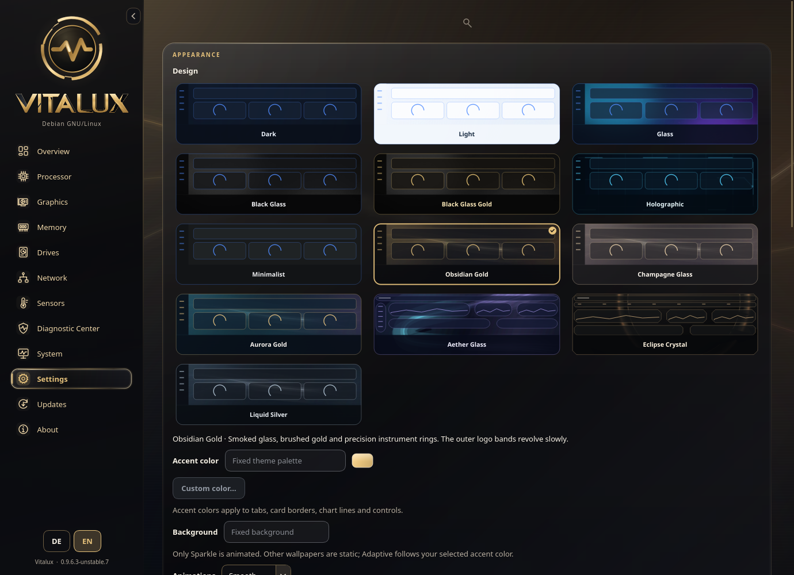

<p align="center">
  <picture>
    <source media="(prefers-color-scheme: dark)" srcset="assets/vitalux-readme-dark-animated.svg">
    <source media="(prefers-color-scheme: light)" srcset="assets/vitalux-readme-light-animated.svg">
    
  </picture>
</p>

<p align="center"><strong>Your Linux system, clearly in view.</strong><br>A native desktop monitor with live telemetry, glass interfaces and practical hardware diagnostics.</p>
<p align="center"><a href="https://github.com/PAAAUUULLOOOH/Vitalux/releases/tag/unstable"><strong>Download</strong></a> · <a href="USER-GUIDE.md">User guide</a> · <a href="CHANGELOG.en.md">Changelog</a> · <a href="https://github.com/PAAAUUULLOOOH/Vitalux/issues">Support</a> · <a href="THIRD-PARTY.md">Licenses</a></p>


**Unstable preview**, based on Stable v0.9.6.2. Test downloads use the rolling [Unstable release](https://github.com/PAAAUUULLOOOH/Vitalux/releases/tag/unstable); [Main / Latest](https://github.com/PAAAUUULLOOOH/Vitalux/releases/latest) remains Stable.

## Features

- Live CPU, GPU, memory, storage, network and sensor measurements, with charts, alerts and local history.
- A rearrangeable dashboard, MiniHUD and thirteen coordinated designs, including **Liquid Silver**: Obsidian Gold’s interface in satin silver and dark smoked glass. **Obsidian Gold is the default.**
- Per-app connections, usage warnings and optional, reversible TCP/UDP session blocks.
- SMART information, drive benchmarks and local diagnostic reports.
- German and English interfaces, guides and release notes; monitoring works offline.

Missing readings stay unavailable. Hostname lookups run only on request; update checks contact the official GitHub release service.

## Requirements

**Linux x86-64, glibc 2.38 or newer, and an X11 or Wayland desktop.** Release packages include Python 3.12 and Qt: no pip or system Python is needed. CPU rendering is the default; optional GPU modes require suitable drivers. Sensor availability depends on hardware and permissions.

Full app networking additionally requires cgroup v2/BPF, process-fork tracepoints, Polkit (`pkexec`) and `/usr/bin/python3`. Authorization is requested when needed. See the [network guide](USER-GUIDE.md#apps-and-network-connections) for session scope and kernel requirements.

## Start Vitalux

Download a package from the [Unstable release](https://github.com/PAAAUUULLOOOH/Vitalux/releases/tag/unstable).

**AppImage:**

```bash
chmod +x Vitalux-v0.9.6.3-unstable.7-x86_64.AppImage
./Vitalux-v0.9.6.3-unstable.7-x86_64.AppImage
```

First launch offers user-account installation or **Run once**. Use `--portable` to skip integration, `--install` to add it later, or `--uninstall` to remove it while keeping preferences.

**Portable ZIP:** extract the complete `Vitalux-v0.9.6.3-unstable.7-linux-x86_64.zip` into its own writable folder:

```bash
cd Vitalux-v0.9.6.3-unstable.7
bash run.sh
```

Vitalux runs once per user across current ZIP and AppImage editions, including Stable/Unstable. Starting it again shows “Vitalux is already running”; quit the running instance before switching editions.

Keep the runtime, libraries, assets and launcher together. **Code → Download ZIP** also includes the runtime; first launch extracts it offline using `tar`, `xz` and `sha256sum`. Manual `Update-von-...zip` overlays are only for the immediately preceding ZIP edition, never AppImages.

## Appearance and controls

Choose a design in **Settings → Appearance**. Hover or keyboard-focus a preview to reveal two small symbols, stacked at its right edge: a color wheel for accents and an image symbol for backgrounds. Colored symbols indicate available options; grey symbols indicate fixed options, without locks. Saved accents and images remain available in compatible designs. Black Glass supports custom colors; fixed palettes use consistently greyed-out color buttons. Liquid Silver uses a fixed silver palette and dark background, with the same interface as Obsidian Gold.

<details>
<summary>Preview the designs</summary>



</details>

Settings search glides to matches and closes softly after five seconds. **Advanced settings** contains renderers and Maintenance; the full **Restore defaults** action sits at the bottom and restarts Vitalux. Section resets apply in place. Optional soft click sounds default to 50% volume. On/off controls use themed switches; multiple selections retain checkmarks.

See the [user guide](USER-GUIDE.md) for design restrictions, graphics, network controls and detailed help, or open **About → Guide** inside Vitalux.

## Updates and channels

Everything stays in **Updates**: installed version and check status at the top, **Stable / Unstable** and their changelogs below. Release notes stay visible. A **Version** selector browses each channel’s history without changing the installation target. Clicking a channel only browses its notes; a separate action shows the target version and prepares installation. Unstable is selectable for installation only when a verified test build contains genuinely newer app changes. GitHub's **Latest** download remains Stable.

The update bar shows a centered percentage for the complete preparation process. Slow downloads report progress in smaller chunks; an idle connection times out. Use **Cancel download** while downloading or **Retry download** after a failure. If the server omits its size header, verified release metadata supplies the total. Without either size, progress stays at 0 until reception completes. Verification and preparation occupy the final part of the bar.

After a verified update or channel switch, Vitalux finishes background work and **restarts automatically**. The target stays fixed throughout. An activation failure retains recovery data and offers **Retry**. Stable and Unstable use separate profiles; only the first test launch copies Stable preferences. **Delete personal preferences** restores defaults and reopens the guide for the active profile. When starting from the older Stable v0.9.6.2, its existing updater still requires **Restart now** once to enter Unstable. Promoting this updater to Stable also makes Stable → Unstable restarts automatic. Notes follow your selected language and remain readable offline. Cached information alone cannot authorize an update.

Updates check SHA-256 and preserve recovery data. For manual verification, put the matching release manifest beside your downloads and run:

```bash
sha256sum --ignore-missing -c Vitalux-v0.9.6.3-unstable.7-SHA256SUMS.txt
```

A matching checksum verifies consistency with that manifest, not an independent digital signature.

## Help

For an incomplete ZIP or missing runtime, extract it again into a fresh folder and check:

```bash
bash Portable-pruefen.sh
VITALUX_RENDERER=software bash run.sh
```

For an AppImage/FUSE problem:

```bash
./Vitalux-v0.9.6.3-unstable.7-x86_64.AppImage --appimage-extract
VITALUX_RENDERER=software bash squashfs-root/AppRun --portable
```

Preferences normally live in `~/.config/vitalux/`; logs in `~/.local/state/vitalux/`. XDG variables can change these paths. For [support](https://github.com/PAAAUUULLOOOH/Vitalux/issues), include the version, distribution, session, renderer and reproduction steps. Diagnostic exports remain local until you share them. Preview launchers use a separate profile and disable updates.

## Development

Use Python 3.12 in a virtual environment:

```bash
python3.12 -m venv .venv
.venv/bin/python -m pip install -r requirements-dev.txt
.venv/bin/python -m vitalux
.venv/bin/python scripts/run-regressions.py
```

Release validation also covers native renderers, audio, offline startup, AppImage integration and update/rollback. Versions use four components: `0.9.5.9 → 0.9.6.0`.

## Credits and licenses

Developed by **[PAAAUUULLOOOH](https://github.com/PAAAUUULLOOOH)**. Thanks to **[TimBooH](https://github.com/TimBooH)** for help with backgrounds and graphics integration.

Bundled components include CPython, Qt/PySide6, Shiboken, psutil, fio, libaio and supporting libraries. **[THIRD-PARTY.md](THIRD-PARTY.md)** and **[licenses/](licenses/README.md)** contain notices, versions, source references and LGPL replacement instructions. Releases include a separate **ThirdPartySources ZIP**.

Original Vitalux code and branding currently have no general public license; see **[LICENSE-NOTICE.md](LICENSE-NOTICE.md)**. Third-party rights, warranty disclaimers and trademark rules remain independent; these notices do not claim legal clearance.
