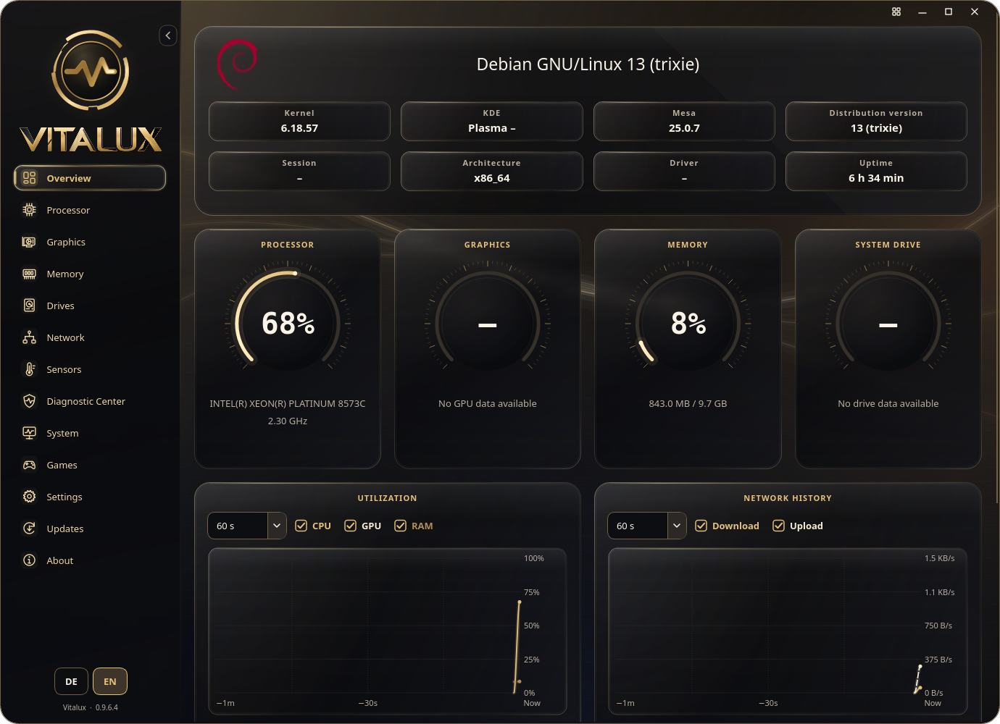

<p align="center">
  <picture>
    <source media="(prefers-color-scheme: dark)" srcset="assets/vitalux-readme-dark-animated.svg">
    <source media="(prefers-color-scheme: light)" srcset="assets/vitalux-readme-light-animated.svg">
    
  </picture>
</p>

<p align="center"><strong>Your Linux system, clearly in view.</strong><br>A native desktop monitor with live telemetry, glass interfaces and practical hardware diagnostics.</p>
<p align="center"><a href="https://github.com/PAAAUUULLOOOH/Vitalux/releases/latest"><strong>Download</strong></a> · <a href="USER-GUIDE.md">User guide</a> · <a href="CHANGELOG.en.md">Changelog</a> · <a href="https://github.com/PAAAUUULLOOOH/Vitalux/issues">Support</a> · <a href="THIRD-PARTY.md">Licenses</a></p>



**Unstable v0.9.6.4-unstable.9.** Download this test build from the rolling [Unstable release](https://github.com/PAAAUUULLOOOH/Vitalux/releases/tag/unstable), or use the current [Stable release](https://github.com/PAAAUUULLOOOH/Vitalux/releases/latest) for daily use.

## Features

- Live CPU, GPU, memory, storage, network and sensor measurements, with saved chart choices, alerts and local history. Multi-GPU systems can select a preferred GPU for the overview, desktop overlay and diagnostics.
- A rounded, frameless main window with edge-aligned navigation, integrated window controls and native dragging/resizing. Content scrolls behind the fixed controls; designs with a header combine them in one continuous surface.
- A rearrangeable dashboard, desktop overlay and six customizable designs, from smoked glass and glass instruments to prismatic space and reactor HUDs. **Obsidian Gold is the default.**
- A Games library with automatic Steam, Heroic and Lutris discovery, wide Steam capsules cached for offline use, per-game MangoHud profiles and local post-game FPS/frametime reports. Saving an enabled profile connects the game once its launcher is closed. The bundled 32/64-bit OpenGL/Vulkan overlay supports Steam’s container runtime and Flatpak; no separate MangoHud installation is needed.
- Per-app connections, usage warnings and optional, reversible TCP/UDP session blocks.
- SMART information, drive benchmarks and local diagnostic reports.
- Measured component power where supported, with current GPU watts and a readable power limit alongside the live values.
- Complete CPU/thread meters and broader hardware identification, with centered component information and matching product pictures. CPU, GPU and mainboard headers include manufacturer specifications and a complete-specifications dialog. Cutouts are preferred; matching photos with backgrounds are used when needed. Pictures remain available offline. A component context menu can refresh its data, reject a wrong image or choose a local picture.
- **Crystal Atrium:** the glass surfaces on the original static Atrium background, with editable overview tiles. The restored design uses the shared overview layout and current rounded gallery previews.
- One selectable CPU history chart with separate unit scales for usage, temperature and clock speed.
- German and English interfaces, manufacturer datasheets, guides and release notes; monitoring and cached product data work offline.

Background image caches are bounded without reducing image resolution or animation quality. Sampling failures are marked explicitly, and missing sensors do not trigger a false recovery.

Missing sensor fields are hidden; real zeroes such as stopped fans remain visible. CPU, GPU and board power describe their reported domains, never total PC wall power. Hostname lookups run only on request; update checks contact the official GitHub release service.

## Requirements

**Linux x86-64, glibc 2.38 or newer, and an X11 or Wayland desktop.** Release packages include Python 3.12 and Qt: no pip or system Python is needed. CPU rendering is the default; optional GPU modes require suitable drivers. Sensor availability depends on hardware and permissions.

Full app networking additionally requires cgroup v2/BPF, process-fork tracepoints, Polkit (`pkexec`) and `/usr/bin/python3`. Authorization is requested when needed. See the [network guide](USER-GUIDE.md#apps-and-network-connections) for session scope and kernel requirements.

## Start Vitalux

Download a package from the [Stable release](https://github.com/PAAAUUULLOOOH/Vitalux/releases/latest).

**AppImage:**

```bash
chmod +x Vitalux-v0.9.6.3-x86_64.AppImage
./Vitalux-v0.9.6.3-x86_64.AppImage
```

First launch offers user-account installation or **Run once**. Use `--portable` to skip integration, `--install` to add it later, or `--uninstall` to remove it while keeping preferences.

**Portable ZIP:** extract the complete `Vitalux-v0.9.6.3-linux-x86_64.zip` into its own writable folder:

```bash
cd Vitalux-v0.9.6.3
bash run.sh
```

Vitalux runs once per user across current ZIP and AppImage editions, including Stable/Unstable. Starting it again shows “Vitalux is already running”; quit the running instance before switching editions.

Keep the runtime, libraries, assets and launcher together. **Code → Download ZIP** also includes the runtime; first launch extracts it offline using `tar`, `xz` and `sha256sum`. Manual `Update-von-...zip` overlays are only for the immediately preceding ZIP edition, never AppImages.

## Appearance and controls

Choose **Obsidian Gold**, **Glass**, **Crystal Atrium**, **Nebula Prism**, **Quantum Core** or **Light** in **Settings → Appearance**. Each design supports preset or custom accent colors and independently selectable backgrounds. The original names of retired designs identify their saved background and color presets; these presets do not change the selected design's layout or effects.

All designs share readable card interiors, consistent value hierarchy, adaptive content gutters and matching in-app dialogs. Hover, search and navigation use coordinated motion. Available updates have a clearly visible navigation marker; reduced motion, animations off and Ultra Eco retain a static marker. Appearance transitions blend at their original brightness.

**Original colors** and **Original background** restore the active design's factory choices. Customization is remembered separately for each design; **Reset design** resets only its colors and background, keeping imported pictures, saved colors and other designs intact. Rounded preview tiles clip their artwork and keep the selected check inside the upper-right corner.

Overview captions are centered in a consistent order below equally sized load displays. The larger system header centers the distribution name across the whole card, with a larger logo and roomier information chips. Long names are shortened; hover over a shortened caption to read its complete text. GPU overview cards omit watts; current GPU power and its limit remain on Graphics. **Show component pictures** in Appearance controls CPU, GPU, RAM and mainboard photos globally. Turning it off stops new picture lookups while keeping cached pictures. Component information stays centered with pictures shown, hidden or unavailable.

**All specifications** opens a scrollable in-app datasheet for the exact CPU, graphics-card or mainboard model. Available manufacturer data is cached for offline use; **Open manufacturer page** links to the original. Detected local specifications remain available when online data is missing. Graphics groups utilization, video-memory usage and the other live readings under **Current GPU values**, without the duplicate sensor panel.

A startup window follows the saved design and shows the actual preparation stage while hardware discovery, first measurements, cached pictures/specifications and the interface are prepared. Existing data is loaded before the main window opens; missing online data does not hold startup open. Motion-off and Ultra Eco use a static startup view.

**Ultra Eco** temporarily uses a plain skin, CPU rendering and a ten-second sample interval. Turning it off restores the last design and its saved appearance. Quantum Core and Crystal Atrium retain static factory backgrounds; logo and instrument motion follow the animation setting.


## Updates and channels

Everything stays in **Updates**. The installed label shows the full running version, including its Unstable test number, independently of browsing or prepared downloads: installed version and check status at the top, **Stable / Unstable** and their changelogs below. Release notes stay visible in a bounded area; a scrollbar appears only when the text is too long. The **Version** selector browses each channel’s history from the top without changing the installation target. Clicking a channel only browses its notes; a separate action shows the target version and prepares installation. Unstable is selectable for installation only when a verified test build contains genuinely newer app changes. GitHub's **Latest** download remains Stable.

The update bar shows a centered percentage for the complete preparation process. Slow downloads report progress in smaller chunks; an idle connection times out. Use **Cancel download** while downloading or **Retry download** after a failure. If the server omits its size header, verified release metadata supplies the total. Without either size, progress stays at 0 until reception completes. Verification and preparation occupy the final part of the bar.

When a fresh verified check confirms that Stable contains all current Unstable changes and there is no separate test offer, Vitalux automatically installs Stable and restarts into its separate profile. New test builds never move a Stable installation back automatically; entering Unstable remains a manual action.

After a verified update or channel switch, Vitalux finishes background work and **restarts automatically**. A fresh parity check can promote a prepared Unstable update directly to Stable, including during download and before restarting. Browsing other channels never changes the prepared target. Temporary restart preparation failures are retried automatically, up to three attempts; persistent failures retain the verified package and show an explicit recovery action. Stable and Unstable use separate profiles; only the first test launch copies Stable preferences. **Restore defaults** in Maintenance fully resets only the active profile and reopens the guide. Upgrading from v0.9.6.2 still requires its existing **Restart now** action once; current versions restart automatically after verified preparation. Notes follow your selected language and remain readable offline. Cached information alone cannot authorize an update.

Updates check SHA-256 and preserve recovery data. For manual verification, put the matching release manifest beside your downloads and run:

```bash
sha256sum --ignore-missing -c Vitalux-v0.9.6.3-SHA256SUMS.txt
```

A matching checksum verifies consistency with that manifest, not an independent digital signature.

## Help

For an incomplete ZIP or missing runtime, extract it again into a fresh folder and check:

```bash
bash Portable-pruefen.sh
VITALUX_RENDERER=software bash run.sh
```

For an AppImage/FUSE problem:

```bash
./Vitalux-v0.9.6.3-x86_64.AppImage --appimage-extract
VITALUX_RENDERER=software bash squashfs-root/AppRun --portable
```

The Diagnostic Center shows the five latest app events. Missing sensor fields are hidden, and recovered readings appear again automatically. Logs rotate at approximately 5 MB with one backup per file; complete error records may slightly exceed that limit.

Preferences normally live in `~/.config/vitalux/`; logs in `~/.local/state/vitalux/`. XDG variables can change these paths. For [support](https://github.com/PAAAUUULLOOOH/Vitalux/issues), include the version, distribution, session, renderer and reproduction steps. Diagnostic exports remain local until you share them. Preview launchers use a separate profile and disable updates.

## Development

Clone the source for development; release packages omit build and test tools. Use Python 3.12 in a virtual environment:

```bash
git clone --branch unstable https://github.com/PAAAUUULLOOOH/Vitalux.git
cd Vitalux
python3.12 -m venv .venv
.venv/bin/python -m pip install -r requirements-dev.txt
.venv/bin/python -m vitalux
.venv/bin/python scripts/run-regressions.py
```

Release validation also covers native renderers, offline startup, AppImage integration and update/rollback. Versions use four components: `0.9.5.9 → 0.9.6.0`.

## Credits and licenses

Developed by **[PAAAUUULLOOOH](https://github.com/PAAAUUULLOOOH)**. Thanks to **[TimBooH](https://github.com/TimBooH)** for help with backgrounds and graphics integration.

Bundled components include CPython, Qt/PySide6, Shiboken, psutil, fio, libaio and supporting libraries. **[THIRD-PARTY.md](THIRD-PARTY.md)** and **[licenses/](licenses/README.md)** contain notices, versions, source references and LGPL replacement instructions. Releases include a separate **ThirdPartySources ZIP**.

Original Vitalux code and branding currently have no general public license; see **[LICENSE-NOTICE.md](LICENSE-NOTICE.md)**. Third-party rights, warranty disclaimers and trademark rules remain independent; these notices do not claim legal clearance.
