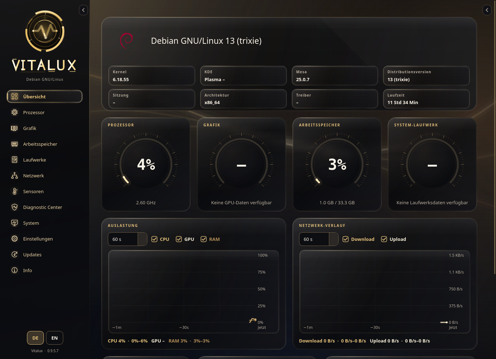
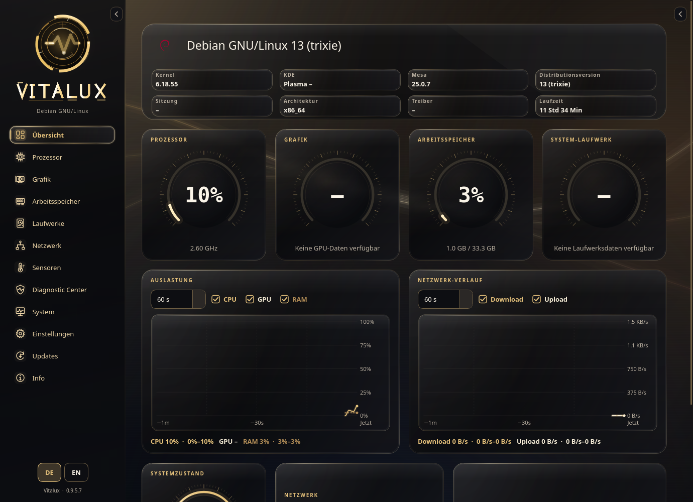

# Übersicht im Vergleich

Oben siehst du den normalen Systemkopf, darunter die kompakte Ansicht. Beide Aufnahmen zeigen Vitalux v0.9.5.7 in Obsidian Gold bei gleicher Fenstergröße.

## Normale Ansicht

## Kompakte Ansicht

Der obere Systemblock benötigt hier 70 Pixel weniger Höhe. Dadurch sind unten bereits weitere Kacheln sichtbar.

Die Option findest du unter **Einstellungen → Erscheinungsbild → Kompakter Systemkopf auf der Übersicht**.
